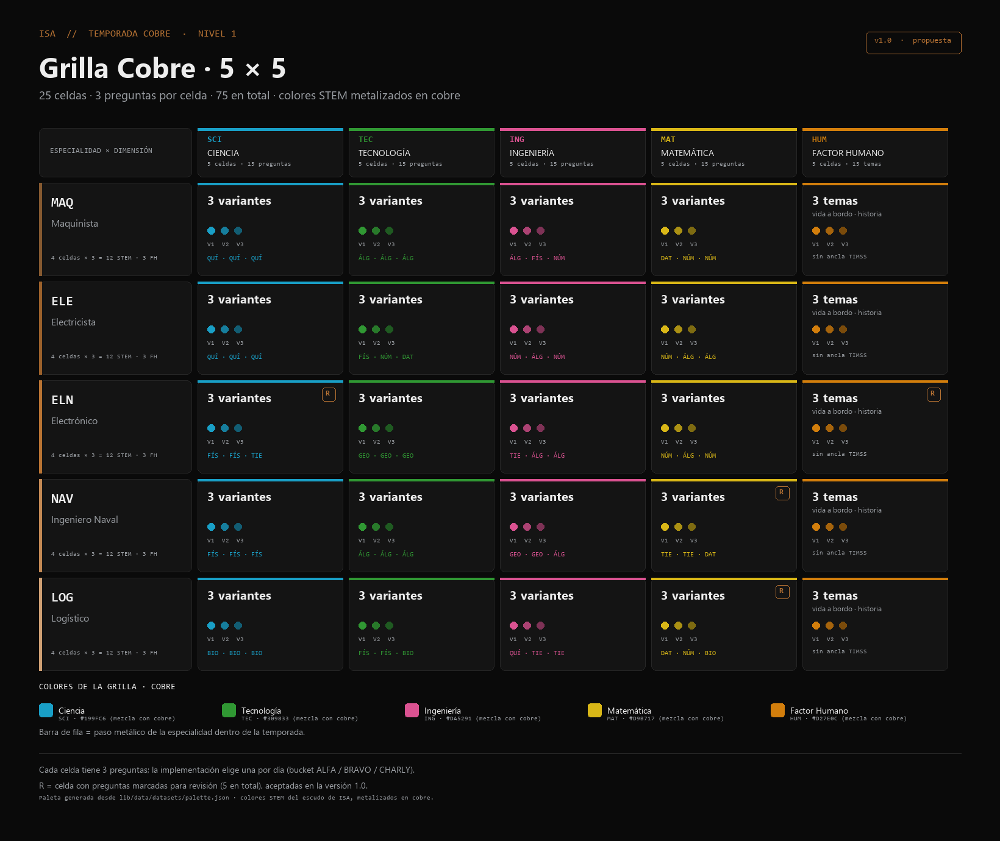
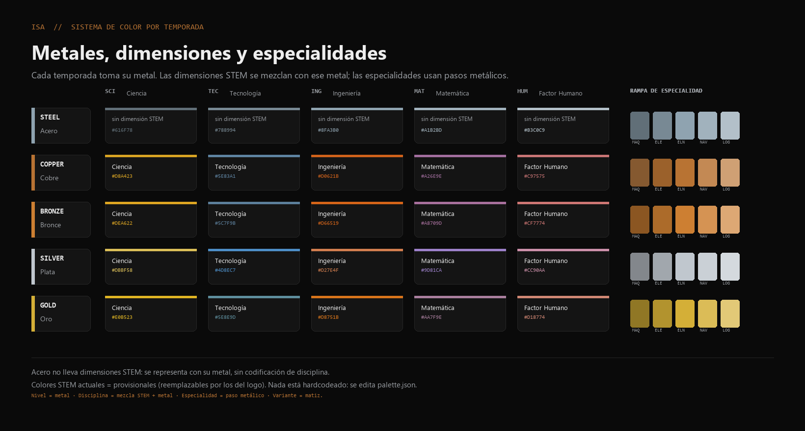

# Grilla Cobre · sistema de color por temporada

**Estado:** propuesta v1.0, 9/11/2026.
**Fuente de verdad:** `lib/data/datasets/palette.json` (todos los hex salen de ahí).
**Visual:** `artifacts/grilla-cobre/grilla-cobre.png` y `paleta-temporadas.png`.





## 1. Principio: el color informa cuatro cosas

| Canal | Qué comunica | Cómo |
|---|---|---|
| **Nivel / temporada** | El metal del nivel | Familia metálica: acero, cobre, bronce, plata, oro |
| **Disciplina STEM** | La dimensión | Tono STEM mezclado con el metal de la temporada |
| **Especialidad** | La fila | Paso metálico de la temporada (5 pasos, del oscuro al claro) |
| **Variante** | Cuál de las 3 preguntas | Matiz del color de la disciplina (100 %, 78 %, 56 %) |

El color no va solo: siempre está acompañado por código y etiqueta (`SCI`, `MAQ`,
`V1 V2 V3`). Así el sistema funciona también para daltonismo y en impresión.

## 2. Regla de composición (parametrizable)

```
colorDisciplina = mezclar(tonoSTEM, metalTemporada, 0.28)
                → subir saturación ×1.22
                → garantizar contraste ≥ 4.5:1 sobre #0A0A0A
especialidad    = rampa de 5 pasos del metal (±16 % hacia negro/blanco)
variante        = colorDisciplina mezclado hacia el fondo (0 %, 22 %, 44 %)
```

Todo está en `palette.json`: si cambian los colores STEM del logo, se edita **una sola
tabla** y se regeneran la grilla y las planillas. **Nada está hardcodeado** en componentes.

## 3. Metales de temporada

| Temporada | Metal | Hex |
|---|---|---|
| Acero | Acero | `#8FA3B0` |
| Cobre | Cobre | `#B87333` |
| Bronce | Bronce | `#CD7F32` |
| Plata | Plata | `#C0C7CE` |
| Oro | Oro | `#D4AF37` |

**Acero no lleva dimensiones STEM**: se representa con su metal, sin codificación de
disciplina (no tiene preguntas TIMSS). Cobre en adelante usa la mezcla.

## 4. Cobre · colores de dimensión

| Dimensión | Hex | Contraste sobre tarjeta |
|---|---|---|
| Ciencia | `#199FC6` (cian cobreado) | 5,98:1 |
| Tecnología | `#309833` (verde cobreado) | 4,97:1 |
| Ingeniería | `#DA5291` (magenta cobreado) | 4,91:1 |
| Matemática | `#D9B717` (amarillo cobreado) | 9,42:1 |
| Factor Humano | `#D27E0C` (naranja cobreado) | 5,90:1 |

Rampa de especialidad en Cobre: `#855930` · `#9B612B` · `#B87333` · `#C38954` · `#CFA074`
(MAQ → LOG). Los dos primeros pasos son estructurales (barras), no texto; siempre van con
la etiqueta de la fila.

## 5. Colores STEM: los del escudo de ISA

Los tonos base salen del escudo de la academia (`lib/missions.ts`, `DISCIPLINE_META`):

| Dimensión | Tono base del escudo |
|---|---|
| Ciencia | `#14B4F0` |
| Tecnología | `#22A34A` |
| Ingeniería | `#D6339A` |
| Matemática | `#E2D23C` |
| Factor Humano | `#D9942F` |

El color de la grilla es la mezcla de ese tono con el metal de la temporada
(`metal_weight`, hoy 0,22) más un ajuste de saturación. Si el equipo de arte ajusta el
peso metálico o los tonos, se cambia en `palette.json` y se regenera; ningún componente
ni documento necesita edición.

## 6. Uso en la app

1. `palette.json` es la única fuente de color; el componente no escribe hex propios.
2. **Implementado:** `components/learn/copper-grid.tsx` renderiza la grilla 5×5 en
   `/series`, leyendo `lib/data/datasets/cobre-grid.json` (20 celdas × 3 variantes) y
   `palette.json` (colores de Cobre). Muestra dimensión, especialidad, variantes y codes.
3. Pendiente: exponer los tokens como variables CSS (`--grid-sci`, …), estados de
   completada/bloqueada con progreso real y enlaces a la experiencia de cada celda.
4. Las Challenge Coins y badges usan la misma familia: metal del nivel + tono de la
   disciplina; los PNG actuales son provisorios hasta la sesión de Arte.

## 7. Accesibilidad

- Contraste AA/AAA en todo el texto; los cinco colores de Cobre superan 4,5:1 sobre fondo.
- La información nunca depende solo del color: códigos, etiquetas, `V1 V2 V3`, `R`.
- No se usa el verde neón de CTA (`#00FF88`) para texto de grilla.
- Las barras metálicas de especialidad son elementos estructurales (≥ 3:1), no texto.

## 8. Pendientes

1. Reemplazar los tonos STEM por los del logo oficial (equipo de arte).
2. Definir arte final de badges con esta lógica de metal + disciplina.
3. Construir el componente real de grilla y verificar contraste en navegador.
